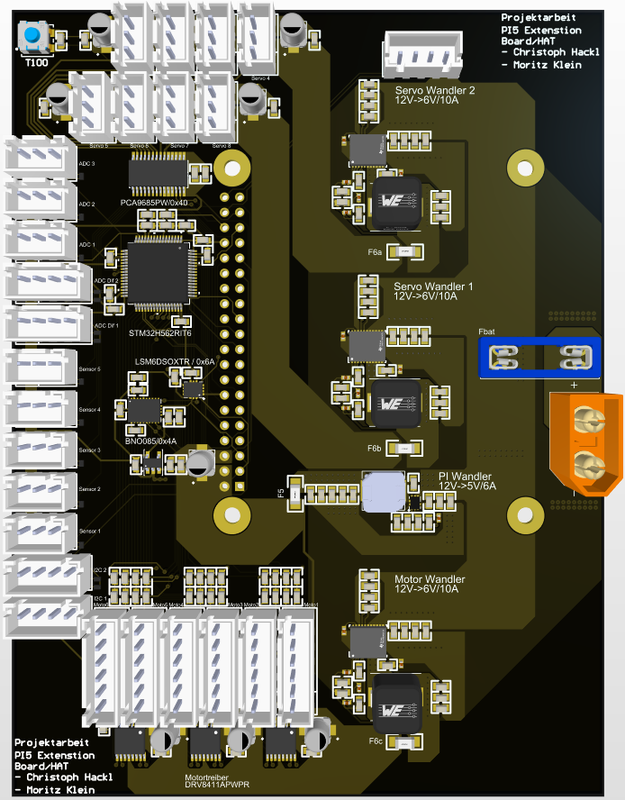
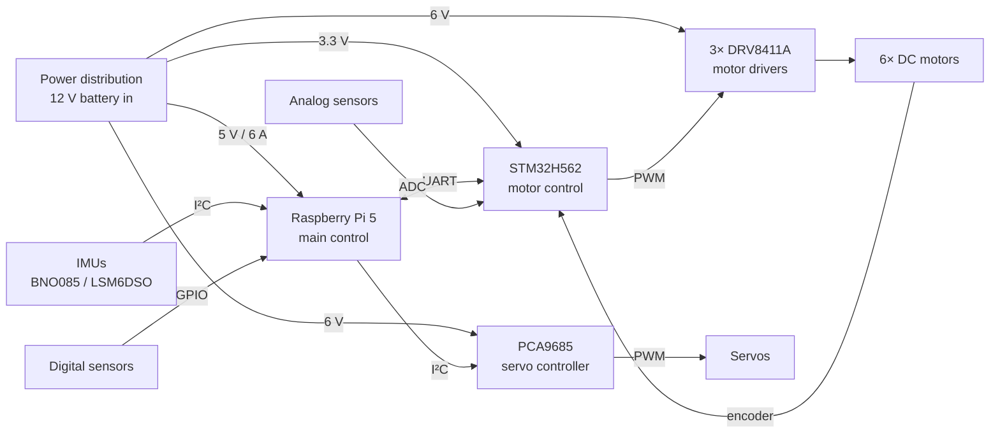

# Raspberry Pi 5 Robotics Controller

A custom **6-layer extension board** that turns a Raspberry Pi 5 into a complete robotics controller.
Motor drivers, servo outputs, IMUs, analog/digital sensor inputs and power distribution from a
single 3S Li-Ion battery are combined on one PCB, with an **STM32H562 co-processor** handling all
real-time tasks.

Developed as a project at HTL St. Pölten (class 4AHELS, school year 2025/26) by
**Christoph Hackl** and **Moritz Klein**.

<p align="center">
  
</p>

---

## Features

| Area | Implementation |
|---|---|
| Main computer | Raspberry Pi 5 (16 GB) mounted directly on the board, optional AI HAT+ (26 TOPS) |
| Real-time co-processor | STM32H562RIT6 (Cortex-M33), programmed/debugged via SWD |
| DC motors | 6 brushed DC motors via 3× TI DRV8411A dual H-bridges, PWM from the STM32 |
| Encoders | 6 quadrature encoder inputs, decoded via EXTI interrupts on the STM32 |
| Servos | PCA9685 16-channel PWM controller on I²C, driven by the Raspberry Pi |
| IMUs | BNO085 (sensor fusion / orientation) and LSM6DSO (6-axis) on I²C |
| Analog inputs | 5 ADC channels (partly differential) on the STM32 – the Pi has no ADC |
| Power | 12 V (3S1P battery) input → 5 V / 6 A (Pi), 3.3 V logic, three separate 6 V rails for motors and servos |
| Pi ↔ STM32 link | UART, simple ASCII protocol (see below) |

## System architecture



The Raspberry Pi runs the high-level logic (vision, path planning, decisions) and talks directly
to the IMUs and the servo controller. Everything timing-critical – PWM generation, encoder
counting and analog acquisition – is offloaded to the STM32.

## Repository structure

```
├── hardware/                     Altium Designer project
│   ├── PI5_Robo_Board/           schematics (*.SchDoc), PCB (*.PcbDoc), BOM, output job
│   │   ├── PI5_Robo_Board.pdf    ► schematic as PDF (no Altium needed)
│   │   └── Project Outputs…/     Gerber + NC drill files, DRC report
│   ├── Librarys/                 component libraries (schematic symbols + footprints)
│   └── Rules/                    6-layer / 1 oz design rules
├── firmware/                     STM32CubeIDE project (STM32H562RIT6)
│   ├── Core/Src/main.c           motor PWM, encoder decoding, ADC, UART protocol
│   └── Robotik2.ioc              CubeMX pin / clock configuration
├── software/raspberry-pi/        Python UART client for the Pi
└── docs/
    ├── report/                   ► full project documentation (LaTeX + PDF, German)
    ├── paper/                    short paper (IEEE format, English)
    ├── presentation/             project presentation
    ├── datasheets/               datasheets of the key components
    └── project-management/       project proposal, pin assignment, cost & order lists
```

**Quick links**
- 📄 [Project documentation (PDF, German)](docs/report/Pi-Robotik_Board.pdf)
- 📄 [Paper (PDF, English)](docs/paper/raspberry-pi-robotics-extension-board.pdf)
- 🔌 [Schematics (PDF)](hardware/PI5_Robo_Board/PI5_Robo_Board.pdf)
- 💾 [Firmware main loop](firmware/Core/Src/main.c)

## UART protocol (Raspberry Pi ↔ STM32)

USART1, **38400 baud, 8N1**, ASCII lines terminated by `\r\n`.

**Command** (Pi → STM32): `M` followed by up to six motor values in percent (−100 … +100).
Values are clamped and converted to PWM duty cycles.

```
M 0 0 0 0 0 80        # motor 6 forward at 80 %, all others stopped
```

**Telemetry** (STM32 → Pi, ~1 Hz):

```
ENC <6 encoder counts> SPD <6 counts per second> PWM <6 applied duty values> ADC <5 raw ADC values>
```

Example from a hardware test:

```
PI : M 0 0 0 0 0 80
STM: ENC 0 0 0 0 0 83120 SPD 0 0 0 0 0 3938 PWM 0 0 0 0 0 80 ADC 805 888 917 2246 2272
```

## Getting started

### Firmware
1. Open STM32CubeIDE → *File → Import → Existing Projects into Workspace* → select `firmware/`.
2. Build the `Debug` configuration.
3. Flash via an ST-Link on the SWD header.

> The STM32 system bootloader only supports UART on fixed pins (see ST AN2606), which differ from
> the board's Pi-UART pins – that's why the board is programmed via SWD.

### Raspberry Pi
Enable the hardware UART (`sudo raspi-config` → *Interface Options → Serial Port*:
login shell **No**, serial hardware **Yes**), reboot, then:

```bash
cd software/raspberry-pi
pip install -r requirements.txt
python3 motor_uart.py 50 -30      # motor 1: +50 %, motor 2: −30 %
```

### Hardware
Open `hardware/PI5_Robo_Board/PI5_Robo_Board.PrjPcb` in Altium Designer.
Manufacturing data is in `hardware/PI5_Robo_Board/Project Outputs for PI5_Robo_Board/`.

## Project status

| Subsystem | Status |
|---|---|
| Power rails (6 V, 5 V, 3.3 V) | ✅ working (after fixing a schematic error in the 6 V converters – see docs) |
| STM32 flashing via SWD | ✅ working |
| UART Pi ↔ STM32 | ✅ working |
| Motor PWM + encoder feedback | ✅ working, verified with oscilloscope |
| Servo PWM (PCA9685) | ✅ working |
| IMU LSM6DSO | ✅ working |
| IMU BNO085 | ⚠️ not detected on I²C (most likely a soldering issue) |

Lessons learned and the issues found during bring-up (converter schematic error, STM32 reset
pull-up, hot-unplug sensitivity of the 5 V converter) are documented in detail in chapter 5 of the
[project documentation](docs/report/Pi-Robotik_Board.pdf).

## Tools

Altium Designer · STM32CubeIDE · Raspberry Pi OS / Python · LaTeX ·
Keysight InfiniiVision DSOX2002A · TTi EL302RD power supply

## Authors

- **Christoph Hackl**
- **Moritz Klein**

Supervisor: Prantl, HTL St. Pölten

The STM32 HAL / CMSIS drivers in `firmware/Drivers/` are © STMicroelectronics / ARM and are
distributed under their respective licenses.
